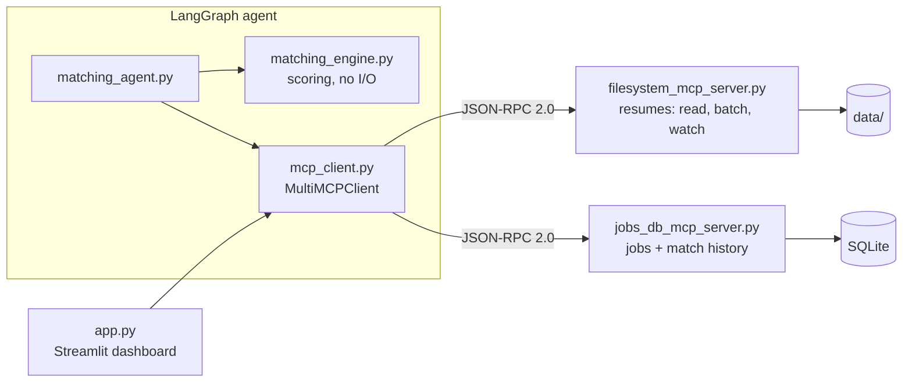
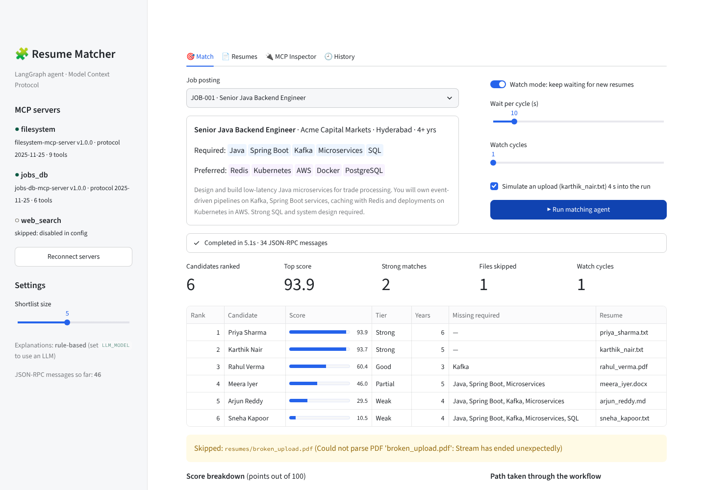
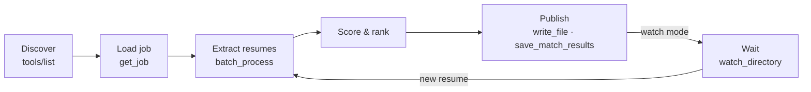

# Resume Matching Agent with MCP

**Milestone 4.** The LangGraph resume-matching agent from Milestone 3, rebuilt so that every file and data operation goes through **Model Context Protocol (MCP)** servers.


**Demo video:** _add your link here_

- **Filesystem MCP server:** the Milestone 1 tools, plus `watch_directory()` and `batch_process()`, behind a JSON-RPC 2.0 interface with resource discovery.
- **MCP-only agent:** the LangGraph agent finds its tools at runtime and never touches the disk itself.
- **Multi-MCP (bonus):** a second server, backed by SQLite, supplies job postings and stores match history.

## Architecture



More diagrams (the LangGraph state machine and the agent ↔ MCP sequence) are in [docs/architecture.md](docs/architecture.md).

## Quick start

**macOS / Linux**

```bash
pip install -r requirements.txt
python scripts/generate_sample_data.py
python matching_agent.py match --job JOB-001
```

**Windows (PowerShell)**

```powershell
powershell -ExecutionPolicy Bypass -File .\setup_windows.ps1
.\.venv\Scripts\python.exe matching_agent.py match --job JOB-001
```

`setup_windows.ps1` finds Python 3.10+, creates `.venv`, installs the requirements and generates the sample data.
On Windows, start every command below with `.\.venv\Scripts\python.exe` instead of `python`.

| Command | What it does |
|---|---|
| `python -m streamlit run app.py` | Dashboard at http://localhost:8501 |
| `python demo.py --pause` | Scripted walkthrough, one section per Enter |
| `python -m pytest -q` | Runs the 59 tests (~15 s) |
| `python matching_agent.py match --job JOB-001 --watch` | Keeps watching for new resumes after the first pass |
| `python matching_agent.py match --job JOB-002 --trace-rpc` | Prints every JSON-RPC message |
| `python matching_agent.py tools` | MCP discovery report for every server |
| `python filesystem_mcp_server.py --transport http` | Serves MCP over HTTP at `127.0.0.1:8765/mcp` |

## Dashboard



The dashboard is just another MCP client. It has four tabs:

- **Match:** run the agent with live status per step, optional watch mode, the ranked shortlist, a score breakdown and the workflow path actually taken.
- **Resumes:** the resumes listed through `resources/list`, with text previews extracted on the server.
- **MCP Inspector:** call any tool and see the JSON-RPC request next to the raw response, plus a live traffic log.
- **History:** past match runs, read from the jobs-db server.

## Part A — the filesystem MCP server

| Tool | Purpose |
|---|---|
| `list_files` · `read_file` · `write_file` · `search_files` · `get_file_metadata` | Milestone 1 tools. PDF and DOCX are converted to text on the server. All paths are sandboxed |
| `watch_directory` | Reports new, modified and deleted resumes. Also pushes `resources/list_changed` notifications |
| `stop_watch` · `list_watches` | Manage active watches |
| `batch_process` | Processes many files on a thread pool. Each file fails on its own, progress is streamed, and extracted text is cached |

**Resources:** `resume://{filename}` · `fs://files/{+path}` · `watch://{watch_id}` · `config://server` · `server://capabilities`

**Configuration:** built-in defaults → `config/filesystem_server.json` → `FS_MCP_*` environment variables → CLI flags.
Unknown keys fail fast, and the effective config can be read at `config://server`.

<details>
<summary><b>Protocol compliance details</b></summary>

<br>

`mcp_protocol.py` implements the MCP spec (revisions 2024-11-05 to 2025-11-25) using only the Python standard library.

| Area | Implemented |
|---|---|
| JSON-RPC 2.0 | Requests, notifications, batch arrays, `id` validation |
| Error codes | `-32700` parse · `-32600` invalid request · `-32601` method not found · `-32602` invalid params · `-32603` internal · `-32002` resource not found · `-32003` not initialized |
| Lifecycle | `initialize` with version negotiation, `notifications/initialized`, `ping`, graceful shutdown |
| Tools | Paginated `tools/list` with JSON Schema and annotations; `tools/call` with `structuredContent` and `isError` |
| Resources | `resources/list`, `resources/templates/list`, `resources/read`, `subscribe`, plus `updated` / `list_changed` notifications |
| Utilities | `logging/setLevel`, progress notifications, cancellation |
| Transports | stdio, and Streamable HTTP with sessions, Origin check and `/health` |

Interoperability is tested against the **official `mcp` Python SDK client**.

</details>

## Part B — the refactored agent

| Milestone 3 | Milestone 4 |
|---|---|
| Tool functions call `open()`, `os.listdir` and PDF parsers | No file I/O in the agent; every step is an `mcp.call(...)` |
| Tool list hard-coded | Tools discovered at runtime via `tools/list` |
| One file at a time | One `batch_process` call with 4 workers |
| Re-run to see new resumes | Watch mode loops on `watch_directory` |
| Results only on disk | Report via `write_file`, plus the run saved in the jobs-db server |



The full state machine, with every conditional edge, is in [docs/architecture.md](docs/architecture.md#2-agent-state-machine-langgraph).

**Multi-MCP:** servers are listed in `mcp_servers.json`, which uses the same format as Claude Desktop's config.
Calls are routed to whichever server owns the tool. Optional servers that fail to start are skipped.
A web-search server is pre-configured but disabled.

**Optional LLM:** set `LLM_MODEL` (for example `openai:gpt-4o-mini`) to get LLM-written match explanations and the `ask` mode.
Without it, everything runs with rule-based explanations.

## Testing

59 pytest scenarios cover protocol compliance, interop with the official SDK, the HTTP transport, watch and batch, full agent runs and the dashboard.
One test disables `open()` and all `pathlib` file access in the agent process, and the full run still passes.

See [docs/test_scenarios.md](docs/test_scenarios.md) for the scenario map and [docs/test_results.txt](docs/test_results.txt) for the latest run.

<details>
<summary><b>Deployment: Claude Desktop, Docker, HTTP</b></summary>

<br>

**Claude Desktop:** copy `claude_desktop_config.example.json` into Claude Desktop's config, fix the paths and restart. Claude then sees all 9 tools and the `resume://` resources.

**Docker (HTTP transport):**

```bash
docker build -t resume-fs-mcp .
docker run -p 8765:8765 -v "$PWD/data:/app/data" resume-fs-mcp
curl localhost:8765/health
```

</details>

<details>
<summary><b>Project structure</b></summary>

<br>

| Path | Contents |
|---|---|
| `filesystem_mcp_server.py` | MCP server: Milestone 1 tools, `watch_directory`, `batch_process`, resources, config |
| `jobs_db_mcp_server.py` | Bonus MCP server: SQLite jobs and match history |
| `mcp_protocol.py` | JSON-RPC 2.0 / MCP protocol core, stdio and HTTP transports |
| `mcp_client.py` | MCP client, multi-server router, LangChain tool adapter |
| `matching_agent.py` | LangGraph workflow and CLI |
| `matching_engine.py` | Pure scoring: skills, TF-IDF, experience |
| `app.py` | Streamlit dashboard |
| `demo.py` | Scripted walkthrough for the demo video |
| `mcp_servers.json` | Which MCP servers the agent connects to |
| `config/` · `scripts/` · `tests/` · `docs/` | Server config · sample-data generator · 59 tests · diagrams and scripts |

</details>

<details>
<summary><b>Troubleshooting on Windows</b></summary>

<br>

If `python` fails with *"The system cannot find the path specified"*, the `python` on your PATH is the Microsoft Store alias or a deleted install.

1. Install Python 3.12 from python.org.
2. Turn off *Settings → Apps → Advanced app settings → App execution aliases → python.exe / python3.exe*.
3. Open a new terminal.

Running everything through `.\.venv\Scripts\python.exe` avoids the problem entirely.

</details>
