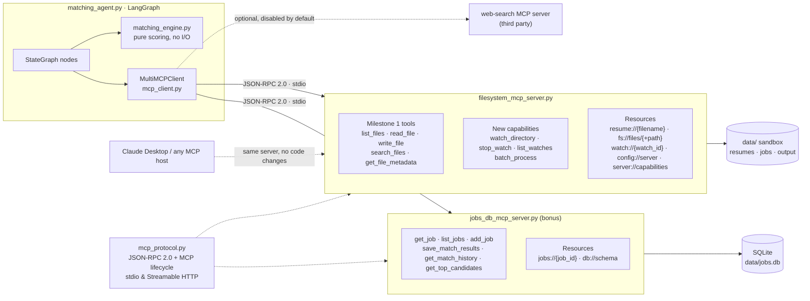
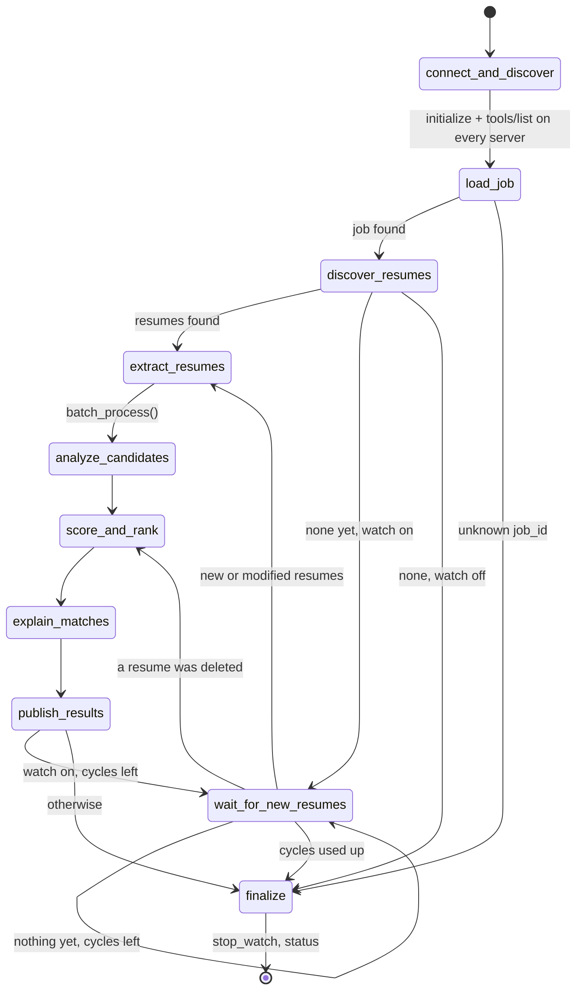
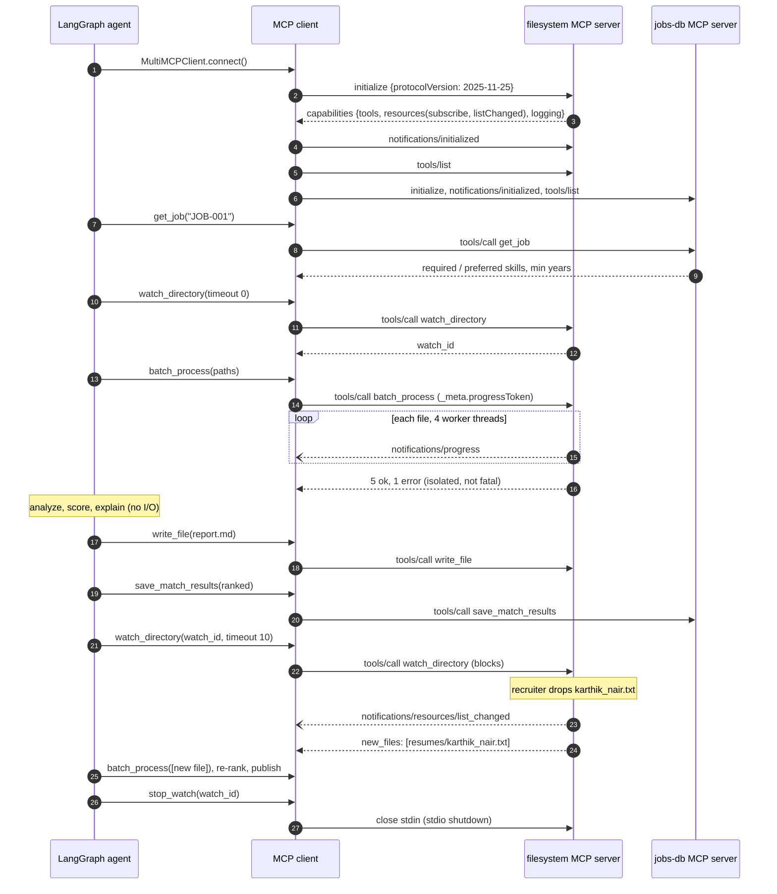

# Architecture & workflow diagrams

GitHub renders these Mermaid diagrams inline. For slides or the demo video, open
[`diagrams.html`](diagrams.html) in a browser. It renders the same diagrams full-size.

## 1. Component view

**Milestone 3:** the agent called Python functions that touched the disk directly.
**Milestone 4:** the agent is an MCP *client*. Every byte of resume data crosses a JSON-RPC boundary.

## 2. Agent state machine (LangGraph)

Solid arrows are fixed edges. Labelled arrows are the conditional routers in `matching_agent.py`.
(`python matching_agent.py graph` prints the auto-generated version of this graph.)

| Node | MCP calls | Purpose |
|---|---|---|
| `connect_and_discover` | `initialize`, `tools/list` (each server) | Capability discovery; fail fast if required tools are missing |
| `load_job` | `jobs_db.get_job` → fallback `filesystem.read_file` | Job requirements |
| `discover_resumes` | `watch_directory(timeout=0)`, `list_files` | Start watch **before** reading so no upload is missed |
| `extract_resumes` | `batch_process(operation=extract_text)` + `notifications/progress` | Concurrent PDF/DOCX/TXT extraction; bad files isolated |
| `analyze_candidates` | — | Skills, years, contact (pure Python) |
| `score_and_rank` | — | Hybrid score: skills + TF-IDF + experience |
| `explain_matches` | — (optional LLM) | One-line rationale per candidate |
| `publish_results` | `filesystem.write_file`, `jobs_db.save_match_results` | Markdown report + persisted run |
| `wait_for_new_resumes` | `watch_directory(watch_id, timeout)` | Blocks until a resume arrives / changes / is deleted |
| `finalize` | `stop_watch` | Clean shutdown |

## 3. Agent ↔ MCP interaction (sequence)

## 4. Error model

| Situation | Where it surfaces | Code |
|---|---|---|
| Malformed JSON | JSON-RPC error | `-32700` Parse error |
| Not a JSON-RPC 2.0 object, bad `id`, empty batch | JSON-RPC error | `-32600` Invalid Request |
| Unknown method (e.g. `prompts/list`) | JSON-RPC error | `-32601` Method not found |
| Unknown tool, bad cursor, params not an object | JSON-RPC error | `-32602` Invalid params |
| Request before `initialize` | JSON-RPC error | `-32003` Server not initialized |
| Resource URI that doesn't exist | JSON-RPC error | `-32002` Resource not found |
| Unexpected server bug | JSON-RPC error | `-32603` Internal error |
| Bad tool arguments, path outside sandbox, corrupt PDF, file too large, read-only mode | **Tool result** with `isError: true` and a machine-readable `error` code | `INVALID_ARGUMENTS`, `ACCESS_DENIED`, `PARSE_ERROR`, `FILE_TOO_LARGE`, `READ_ONLY`, … |

Tool-level failures are deliberately *results*, not protocol errors, as the MCP spec recommends,
so an LLM can read the message and correct its next call.
